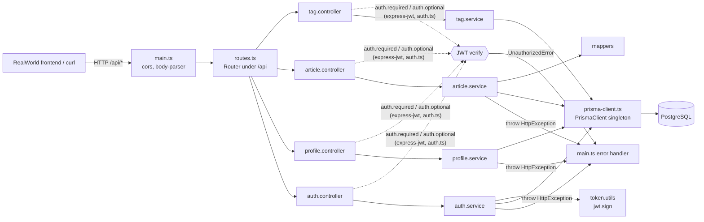
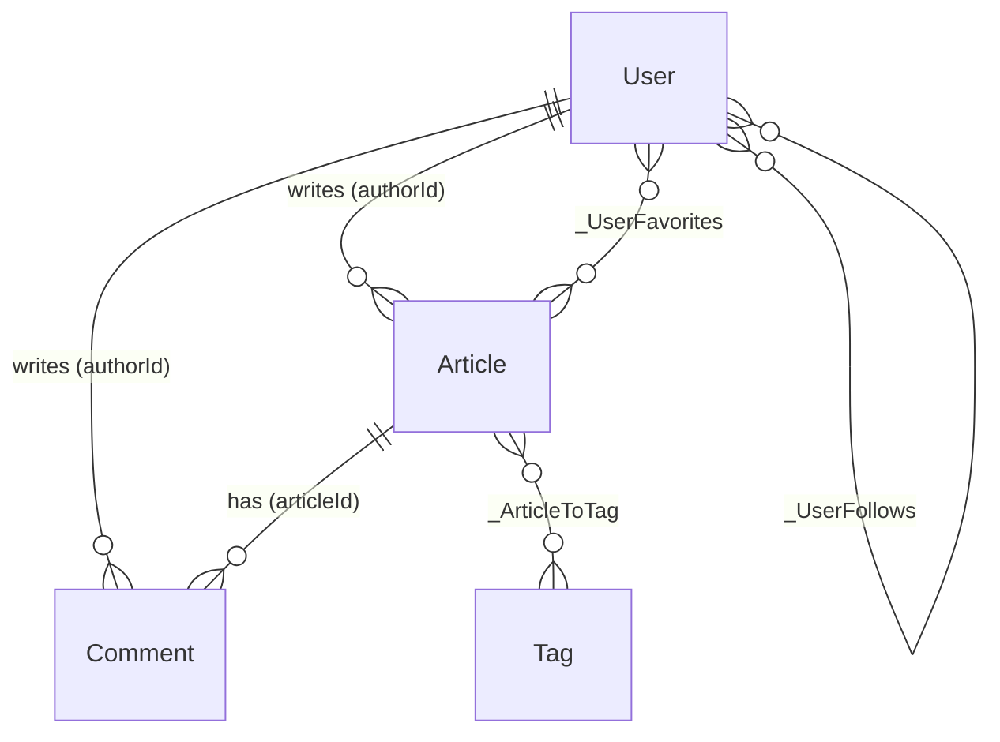

# realworld-api (Conduit API): Repo Guide

> Generated 2026-10-29 from `https://github.com/gothinkster/node-express-realworld-example-app.git` at commit `30b68e1` (master).
> Claims cite `file:line`. *(inferred)* = deduced from names, structure or library behaviour, not confirmed in this repo's code.
> Nothing in the repo was installed, built or run while writing this. Every command below comes from the repo's own manifests and docs.
> Written for a new owner of the service, so it leans toward auth, storage and the local dev loop, as requested.

## TL;DR

This is a single-process **Express 4 + Prisma 4 + PostgreSQL** JSON API written in TypeScript. It implements the [RealWorld](https://github.com/gothinkster/realworld) "Conduit" spec, a Medium-style blogging backend with users, JWT auth, articles, comments, tags, favorites and follows. Every endpoint has the same three layers: an Express router (`*.controller.ts`) that applies JWT middleware, then a service function (`*.service.ts`) that validates input and calls Prisma directly, then a mapper that shapes the response. There is no repository layer, no DI and no background work. Know one thing before you touch it: **list endpoints only show content written by "demo" users or by the caller** (`src/app/routes/article/article.service.ts:13-25`). Content from ordinary users is invisible to everyone else in `/api/articles`, `/api/tags` and comment lists. That rule is deliberate but undocumented, and it will confuse you the first time you test with two accounts.

## What it is and who uses it

- **Kind**: an HTTP/JSON backend service. It is laid out as an Nx workspace with one app project (`api`, `project.json:2`) and a scaffolded e2e project (`e2e/project.json:2`).
- **Consumers**: any RealWorld front end (React, Angular and others), talking to `/api/*`. Request and response shapes follow the RealWorld spec: `{ user: {...} }`, `{ article: {...} }`, `{ articles, articlesCount }`.
- **Maturity**: the project dates from 2016. Most commits are from 2016–2017. After a long gap it was rewritten onto Nx, Prisma and TypeScript in Dec 2023–Jan 2024 (`e40aeb9 chore: move to nx`, `5eeccf1 chore: update to latest demo version`, `30b68e1 fix: missing user id`). Nothing has been committed upstream since 2024-01-04, so treat it as a stable example app and not a fast-moving product.

## Tech stack

| Concern | Choice | Where it's configured |
|---|---|---|
| Language/runtime | TypeScript ~5.2 on Node (Docker uses `node:lts-alpine`) | `tsconfig.json`, `tsconfig.app.json`, `Dockerfile:7` |
| HTTP framework | Express ~4.18, `cors`, `body-parser` | `src/main.ts:7-16` |
| Auth | `express-jwt` 8 (verify) + `jsonwebtoken` 9 (sign), HS256; `bcryptjs` for password hashes | `src/app/routes/auth/auth.ts`, `src/app/routes/auth/token.utils.ts` |
| Storage | PostgreSQL through Prisma ORM 4.16 | `src/prisma/schema.prisma:1-4`, `package.json:11-14` |
| Messaging / jobs | None | n/a |
| Build / packaging | Nx 17 with `@nx/esbuild` (unbundled CJS to `dist/api`), Docker image | `project.json:6-38`, `Dockerfile` |
| Testing | Jest 29 + ts-jest; Prisma mocked with `jest-mock-extended` | `jest.config.ts`, `src/tests/prisma-mock.ts` |
| Lint / format | ESLint (`@nx/typescript`), Prettier (`singleQuote`) | `.eslintrc.json`, `.prettierrc` |
| CI/CD / deploy | **No CI config in the repo.** The README's Travis badge is stale (`README.md:3`). | n/a |
| Seed data | `@ngneat/falso` random data | `src/prisma/seed.ts` |

## Repository map

    src/
      main.ts                      process entry: Express app, middleware, global error handler, listen()
      app/
        models/http-exception.model.ts   the one error type services throw (status + body)
        routes/
          routes.ts                mounts every feature router under /api
          auth/                    users + JWT. START HERE for auth
            auth.ts                express-jwt middlewares: auth.required / auth.optional
            token.utils.ts         generateToken(): signs {user:{id}} for 60 days
            auth.controller.ts     POST /users, POST /users/login, GET/PUT /user
            auth.service.ts        register/login/update logic, bcrypt, uniqueness checks
            user-request.d.ts      augments Express.Request with req.auth.user.id
            *.model.ts             TS interfaces only (not used by Prisma)
          article/                 articles, comments, favorites (the biggest module)
            article.controller.ts  11 routes
            article.service.ts     652 lines: queries, visibility rules, slugs, tags
            article.mapper.ts      DB row -> RealWorld "article" JSON
            author.mapper.ts       DB user -> RealWorld "author" JSON
          profile/                 GET profile, follow/unfollow
          tag/                     GET /tags (top 10)
      prisma/
        schema.prisma              THE data model (source of truth for the DB and the generated client)
        migrations/                SQL produced by `prisma migrate`; don't hand-edit applied ones
        prisma-client.ts           the shared PrismaClient singleton every service imports
        seed.ts                    creates 12 demo users x 12 articles x 12 comments
      assets/images/               static images served by express.static
      tests/                       Jest unit tests (services + mappers), Prisma mocked
    e2e/                           Nx-generated e2e scaffold (one placeholder test, see Gotchas)
    project.json                   Nx targets: build / serve / lint / test / docker-build
    nx.json                        Nx caching + jest "ci" configuration
    Dockerfile                     runtime image; expects `dist/api` to already be built
    dist/, node_modules/, .env     gitignored (`.gitignore`)

## Architecture

**Components**
- **Bootstrap** (`src/main.ts`) builds the app. Middleware runs in this order: `cors()`, JSON and urlencoded body parsing, the API router, static images, `GET /` health message, and finally a single error handler (`src/main.ts:13-47`).
- **Router aggregator** (`src/app/routes/routes.ts:7-13`) mounts four feature routers on one sub-router and puts it under `/api`.
- **Feature modules** (`auth`, `article`, `profile`, `tag`) each follow the same layout:
  - `*.controller.ts` registers routes and attaches `auth.required` or `auth.optional`. It pulls `req.auth?.user?.id`, calls the service, and passes any thrown error to `next(error)`.
  - `*.service.ts` holds the business rules and validation, and issues Prisma queries inline. It throws `HttpException` for expected failures.
  - Mappers (`src/app/routes/article/article.mapper.ts`, `src/app/routes/article/author.mapper.ts`, `src/app/routes/profile/profile.utils.ts`) turn Prisma rows into spec-shaped JSON and compute the `following` and `favorited` booleans for the current user.
- **Persistence**: a single `PrismaClient` (`src/prisma/prisma-client.ts:17`) that every service imports directly.

**Dependency direction** (checked by reading the imports): controller → service → `prisma-client` + mappers + `HttpException`. Modules reach into each other in a few places: `article.service.ts` imports `src/app/routes/profile/profile.utils.ts` and `src/app/routes/tag/tag.model.ts` (`src/app/routes/article/article.service.ts:4-6`), all controllers import `src/app/routes/auth/auth.ts`, and `seed.ts` reuses the auth and article services (`src/prisma/seed.ts:11-12`). Nothing imports controllers except `routes.ts`.

**Runtime topology**: one Node process that listens on `PORT` (default 3000, `src/main.ts:53-57`), plus one PostgreSQL database. No cache, queue, worker or outbound HTTP calls (`axios` is only used by the e2e scaffold).



### Endpoint inventory

All paths are prefixed with `/api` (`src/app/routes/routes.ts:13`). Auth: **R** = `auth.required`, **O** = `auth.optional`, **none** = no middleware.

| Method + path | Auth | Handler → service |
|---|---|---|
| `POST /users` | none | `auth.controller.ts:14` → `createUser` |
| `POST /users/login` | none | `auth.controller.ts:30` → `login` |
| `GET /user` | R | `auth.controller.ts:45` → `getCurrentUser` |
| `PUT /user` | R | `auth.controller.ts:61` → `updateUser` |
| `GET /profiles/:username` | O | `profile.controller.ts:14` → `getProfile` |
| `POST /profiles/:username/follow` | R | `profile.controller.ts:34` → `followUser` |
| `DELETE /profiles/:username/follow` | R | `profile.controller.ts:54` → `unfollowUser` |
| `GET /articles` (`?tag&author&favorited&offset&limit`) | O | `article.controller.ts:30` → `getArticles` |
| `GET /articles/feed` | R | `article.controller.ts:45` → `getFeed` |
| `POST /articles` | R | `article.controller.ts:71` → `createArticle` |
| `GET /articles/:slug` | O | `article.controller.ts:87` → `getArticle` |
| `PUT /articles/:slug` | R | `article.controller.ts:110` → `updateArticle` |
| `DELETE /articles/:slug` | R | `article.controller.ts:129` → `deleteArticle` |
| `GET /articles/:slug/comments` | O | `article.controller.ts:149` → `getCommentsByArticle` |
| `POST /articles/:slug/comments` | R | `article.controller.ts:170` → `addComment` |
| `DELETE /articles/:slug/comments/:id` | R | `article.controller.ts:190` → `deleteComment` |
| `POST /articles/:slug/favorite` | R | `article.controller.ts:210` → `favoriteArticle` |
| `DELETE /articles/:slug/favorite` | R | `article.controller.ts:230` → `unfavoriteArticle` |
| `GET /tags` | O | `tag.controller.ts:13` → `getTags` |
| `GET /` (no `/api`) | none | `src/main.ts:21-23`, returns `{status: 'API is running on /api'}` |

## Key flows

### 1. How auth works (register → login → authenticated request)

**Issuing a token (register)**: `POST /api/users` with body `{ "user": { "email", "username", "password", "image?", "bio?" } }`
1. Route: `src/app/routes/auth/auth.controller.ts:14-21`. The controller forces `demo: false` (line 16), so API-created users are never demo users.
2. Validation: `src/app/routes/auth/auth.service.ts:39-54` trims email, username and password and returns 422 `{errors:{field:["can't be blank"]}}` if any is empty.
3. Uniqueness: `src/app/routes/auth/auth.service.ts:9-36` runs two `findUnique` queries (email, username) and returns 422 `has already been taken`. This is check-then-insert with no transaction. The DB unique indexes are the real guard, and a race there surfaces as a 500 *(inferred)*.
4. Hashing: `bcrypt.hash(password, 10)` (`src/app/routes/auth/auth.service.ts:58`).
5. Persistence: `prisma.user.create` with a `select` that leaves out `password` (`src/app/routes/auth/auth.service.ts:60-76`).
6. Token: `generateToken(user.id)` (`src/app/routes/auth/auth.service.ts:80`) → `jwt.sign({ user: { id } }, JWT_SECRET || 'superSecret', { expiresIn: '60d' })` (`src/app/routes/auth/token.utils.ts:3-6`). The response is 201 `{ user: { id, email, username, bio, image, token } }`.

**Login**: `POST /api/users/login` with `{ "user": { "email", "password" } }`
1. `src/app/routes/auth/auth.controller.ts:30-37` → `login()` (`src/app/routes/auth/auth.service.ts:84-129`).
2. Looks the user up by email, then `bcrypt.compare` (`src/app/routes/auth/auth.service.ts:96-111`).
3. An unknown email and a wrong password both return **403** `{errors:{"email or password":["is invalid"]}}` (`src/app/routes/auth/auth.service.ts:124-128`), not 401. The login response has no `id`, unlike register, `GET /user` and `PUT /user` (`src/app/routes/auth/auth.service.ts:114-120`).

**Using the token**: every protected route
1. The client sends `Authorization: Token <jwt>` (the RealWorld convention) or `Authorization: Bearer <jwt>`. Both are accepted by `getTokenFromHeaders` (`src/app/routes/auth/auth.ts:4-12`).
2. `auth.required` (`src/app/routes/auth/auth.ts:15-19`) is `express-jwt` with HS256 and the same secret fallback. On success it sets `req.auth` to the decoded payload `{ user: { id }, iat, exp }`, which is typed by `src/app/routes/auth/user-request.d.ts:1-9`.
3. `auth.optional` (`src/app/routes/auth/auth.ts:20-25`) sets `credentialsRequired: false`, so a missing header passes through with `req.auth` undefined. A *present but invalid or expired* token is still rejected *(inferred from express-jwt behaviour)*, so a stale token in a front end breaks even public reads like `GET /articles`.
4. Controllers read `req.auth?.user?.id` and pass it to services, for example `src/app/routes/article/article.controller.ts:73`. That user id is the **only identity** in the system: no roles, scopes or sessions. Authorization is done by hand inside services by comparing ownership (`src/app/routes/article/article.service.ts:310-314`, `:404-408`).
5. Failure path: express-jwt throws `UnauthorizedError`. `src/main.ts:34-38` maps every such error (missing, malformed, expired or bad signature) to `401 {status:'error', message:'missing authorization credentials'}`.

**Token lifecycle**: tokens are stateless and last 60 days. There is no refresh, revocation or logout. `GET /user` and `PUT /user` each mint a fresh token on every call (`src/app/routes/auth/auth.service.ts:145-148`, `:179-182`). Changing `JWT_SECRET` invalidates every outstanding token.

### 2. Creating an article (write path): `POST /api/articles`
1. Route + JWT: `src/app/routes/article/article.controller.ts:71-78`, `auth.required`. Body: `{ "article": { title, description, body, tagList? } }`.
2. Validation: `src/app/routes/article/article.service.ts:166-176` returns 422 for a blank title, description or body. `tagList` is silently treated as `[]` if it isn't an array (line 164).
3. Slug: `` `${slugify(title)}-${userId}` `` (`src/app/routes/article/article.service.ts:178`). Including the **author's user id** makes slugs unique per author+title, so two authors can use the same title. The same author reusing a title gets 422 `title must be unique` (`:180-191`).
4. Persistence: one `prisma.article.create` with nested `tagList.connectOrCreate` (tags are upserted by unique `name`) and `author.connect` (`src/app/routes/article/article.service.ts:197-236`). The `include` loads tags, the author with `followedBy`, `favoritedBy` and `_count`.
5. Response shaping: `articleMapper` (`src/app/routes/article/article.mapper.ts:3-14`) flattens `tagList` to strings and computes `favorited`, `favoritesCount` and `author.following` (`src/app/routes/article/author.mapper.ts:3-10`). Returns 201 `{ article }`.
- Errors: expected failures throw `HttpException(status, body)` (`src/app/models/http-exception.model.ts:1-10`). The controller's `catch` → `next(error)` hands them to `src/main.ts:40-42`, which sends `res.status(err.errorCode).json(err.message)`, so the body is whatever object the service passed. Anything else (Prisma errors, TypeErrors) becomes `500` with the raw `err.message` (`src/main.ts:43-44`).

### 3. Listing articles (read path with the "demo" visibility rule): `GET /api/articles`
1. Route: `src/app/routes/article/article.controller.ts:30-37`, `auth.optional`, passes `req.query` and the optional user id.
2. Query building: `buildFindAllQuery` (`src/app/routes/article/article.service.ts:8-67`):
   - the author filter is always `OR: [{demo: true}, {id: currentUser}]` (`:13-25`). **Only demo users' articles and your own are ever listed.**
   - `?author=` adds `AND username = author` (`:27-33`), `?tag=` adds `tagList some name` (`:44-52`), `?favorited=` adds `favoritedBy some username` (`:54-64`).
3. Two queries, `count` and then `findMany`, ordered by `createdAt desc`, with `skip = offset || 0` and `take = limit || 10` (`src/app/routes/article/article.service.ts:71-105`).
4. Each row is mapped with `articleMapper` (`:107-110`). Returns `{ articles, articlesCount }`.
- The same demo-or-self filter is used for tags (`src/app/routes/tag/tag.service.ts:5-24`, top 10 by article count, `:29-34`) and for comments (`src/app/routes/article/article.service.ts:417-441`). It is **not** applied to `GET /articles/feed` (`:113-160`, articles by authors you follow), `GET /articles/:slug` (`:241-274`) or profiles. The seed creates only demo users (`src/prisma/seed.ts:22`), so the public catalogue is the seeded content plus whatever the caller wrote *(inferred: this keeps the public demo free of user spam, judging by commit `5eeccf1 chore: update to latest demo version`)*.

### 4. Updating an article (ownership check + tag replacement): `PUT /api/articles/:slug`
1. `src/app/routes/article/article.controller.ts:110-121` → `updateArticle` (`src/app/routes/article/article.service.ts:289-383`).
2. Loads the article's author (`:292-304`). Missing → 404 with an empty body `{}` (`:306-308`). Not the owner → 403 (`:310-314`).
3. A new title recomputes the slug, and the service checks it is unique (`:316-333`). **Changing the title changes the URL.**
4. **Tags are always wiped first** by `disconnectArticlesTags` (`:276-287`, called at `:343`), and only the tags in the request are reconnected (`:335-341`, `:355-357`). A PUT without `tagList` clears all tags. These are two separate writes with no transaction.
5. Updates the fields that are present, sets `updatedAt` by hand (`:345-358`), and maps the result.

## Data model

Source of truth: `src/prisma/schema.prisma`. SQL history: `src/prisma/migrations/`. Prisma generates the TypeScript client types from the schema. The hand-written `*.model.ts` interfaces (`src/app/routes/auth/user.model.ts`, `src/app/routes/article/article.model.ts`) are loose shapes and are **not** kept in sync with the schema. Most service code uses `any`.

| Model | Key fields | Defined at |
|---|---|---|
| `User` | `id` serial, `email` unique, `username` unique, `password` (bcrypt hash), `image` (default points at `https://api.realworld.io/images/smiley-cyrus.jpeg`), `bio`, `demo` bool default false | `src/prisma/schema.prisma:43-56` |
| `Article` | `id`, `slug` unique, `title`, `description`, `body`, `createdAt`, `updatedAt` (no `@updatedAt`; set by hand), `authorId` → User (cascade delete) | `src/prisma/schema.prisma:11-24` |
| `Comment` | `id`, `body`, timestamps, `articleId` → Article, `authorId` → User (both cascade) | `src/prisma/schema.prisma:26-35` |
| `Tag` | `id`, `name` unique | `src/prisma/schema.prisma:37-41` |

Many-to-many relations are Prisma *implicit* join tables (columns `A`/`B`):
- `_ArticleToTag` (Article ↔ Tag), created in `src/prisma/migrations/20211001143221_implicit_tags/migration.sql:18-21`. It replaced an explicit `ArticleTags` table.
- `_UserFavorites` (Article ↔ User "favoritedBy/favorites"), `src/prisma/migrations/20210924225358_initial/migration.sql:57-60`.
- `_UserFollows` (User ↔ User self-relation "followedBy/following"), `src/prisma/migrations/20210924225358_initial/migration.sql:63-66`. In `followUser`, the **target** user gets the caller added to `followedBy` (`src/app/routes/profile/profile.service.ts:23-33`).



Migrations, in order: `20210924225358_initial` (tables) → `20211001143221_implicit_tags` (explicit tag join → implicit) → `20211105153605_api_url` (new default avatar URL) → `20211221184529_deprecated_preview` (index renames for Prisma 3 naming). The migration lock is pinned to `postgresql` (`src/prisma/migrations/migration_lock.toml:3`).

## Configuration and environment

Config comes from environment variables only. There is no config module, and **the app itself never loads `.env`**: there is no `dotenv` dependency in `package.json`. A `.env` at the repo root is picked up by the Prisma CLI, and very likely by Nx when you run `nx serve` and by Prisma Client at runtime *(inferred from tool behaviour)*. `node dist/api/main.js` on its own will **not** read `JWT_SECRET` from `.env` *(inferred)*.

| Var | Purpose | Default if unset | Read at |
|---|---|---|---|
| `DATABASE_URL` | Postgres connection string | none, Prisma fails | `src/prisma/schema.prisma:3` |
| `JWT_SECRET` | HS256 signing + verify secret | **`'superSecret'`** | `src/app/routes/auth/auth.ts:16`, `src/app/routes/auth/auth.ts:21`, `src/app/routes/auth/token.utils.ts:4` |
| `PORT` | HTTP listen port | `3000` | `src/main.ts:53` |
| `NODE_ENV` | Only effect: `development` caches the Prisma client on `global` | — | `src/prisma/prisma-client.ts:19-21` |
| `HOST` | Set in the Dockerfile and used by the e2e scaffold; **not read by the app** | — | `Dockerfile:9`, `e2e/src/support/test-setup.ts:7` |

The README lists `DATABASE_URL`, `JWT_SECRET` and `NODE_ENV=production` as required (`README.md:27-31`). No feature flags. No secrets manager integration.

## External dependencies and integrations

- **PostgreSQL** is the only integration, reached through Prisma (`src/prisma/prisma-client.ts`). Queries are written inline in each service. There is no raw SQL.
- **Key libraries that shape the code**: `express-jwt` (auth middleware and the `req.auth` convention), `@prisma/client` (all data access, nested writes like `connectOrCreate`), `slugify` (article URLs), `bcryptjs`.
- **External URLs baked into data**: the default user avatar and the seed avatars point at `https://api.realworld.io/images/...` (`src/prisma/schema.prisma:48`, `src/prisma/seed.ts:21`), not at this service. The same images also ship locally in `src/assets/images/` and are served by `express.static` (`src/main.ts:19`).

## Development workflow

Prerequisites *(inferred)*: Node (18.x matches `@types/node` 18.16.9) and a reachable PostgreSQL. The repo has **no docker-compose and no DB container**, so you provide Postgres yourself.

**Setup** (from `README.md`):
```shell
npm install                      # README.md:15
# create .env at the repo root with DATABASE_URL=postgresql://... and JWT_SECRET=...
npx prisma generate              # README.md:38 - generates @prisma/client from src/prisma/schema.prisma
npx prisma migrate deploy        # README.md:46 - applies src/prisma/migrations
npx prisma db seed               # README.md:62 - runs package.json "prisma.seed" (ts-node src/prisma/seed.ts)
```
The schema path is configured in `package.json:13`, so Prisma commands don't need `--schema`. During development you'll create new migrations with `npx prisma migrate dev --name <name>`. That is standard Prisma, not documented in this repo.

**Run**:
```shell
npx nx serve api                 # README.md:54; or `npm start` (package.json:6)
```
`serve` builds with esbuild (development config) and runs `dist/api/main.js` with `@nx/js:node` (`project.json:39-52`), which rebuilds on change *(inferred: @nx/js:node watch is on by default)*. Smoke test: `curl localhost:3000/` → `{"status":"API is running on /api"}`, then `curl localhost:3000/api/tags`.

**Test** (unit):
```shell
npm test                         # = nx test -> jest.config.ts (project.json:60-66)
npx nx test api --configuration=ci   # CI-style with coverage (nx.json:23-28)
npx nx test api --testFile=src/tests/services/auth.service.test.ts   # one file (inferred: standard @nx/jest flag)
```
- Layout: `src/tests/services/*.test.ts` (auth, article, profile, tag) and `src/tests/utils/profile.utils.test.ts`. `testMatch` also picks up any `*.spec.ts` / `*.test.ts` / `__tests__` under `src` (`jest.config.ts:10-13`). Tests are excluded from the app build (`tsconfig.app.json:7-12`).
- Style: service-level unit tests with **no database**. `src/tests/prisma-mock.ts:6-15` replaces the `prisma-client` module with `mockDeep<PrismaClient>()` and resets it before each test. Tests stub calls such as `prismaMock.user.findUnique.mockResolvedValue(...)`. Controllers, middleware, the error handler and `getArticles`/`createArticle`/`updateArticle` have **no tests**. `getTags` is a `test.todo` (`src/tests/services/tag.service.test.ts:3-4`).
- No integration tests against a real Postgres.

**E2E**: `npx nx e2e e2e` (`e2e/project.json:7-14`) expects a server already running on `HOST:PORT`. It currently holds only an Nx placeholder that will fail (see Gotchas).

**Lint / format**: `npx nx lint api` (`project.json:53-59`). Prettier is configured (`.prettierrc`) but has no script. Run `npx prettier --check src` *(inferred)*. Type-checking happens only through ts-jest and your editor; esbuild does not type-check *(inferred)*.

**Build / deploy**:
```shell
npm run build                    # = nx build -> dist/api (production config, generates package.json + lockfile; project.json:6-38)
npx nx docker-build api          # builds first, then `docker build -t api` (project.json:67-70)
docker run -p 3000:3000 -t api   # Dockerfile header comment
```
The README's deploy one-liner `npm ci && npx prisma migrate deploy && node dist/api/main.js` (`README.md:73`) skips the build step, and `dist/` is gitignored, so add `npx nx build api` before it.

**CI**: none in the repo. Nothing gates merges here, so find out what your team's pipeline runs (see Open questions).

## Conventions and patterns

- **One folder per resource** under `src/app/routes/<resource>/` containing `*.controller.ts`, `*.service.ts`, mappers and `*.model.ts`. A new resource needs a controller, a service, and a `.use()` line in `src/app/routes/routes.ts:7-11`.
- **Controller boilerplate**: `async (req, res, next) => { try { ... res.json({ <key>: result }) } catch (e) { next(e) } }`. Express 4 doesn't catch async errors, so **every handler must keep the try/catch** or a rejection will hang the request *(inferred from Express 4 semantics)*. `src/app/routes/profile/profile.controller.ts` is a clean, small example.
- **Errors**: throw `new HttpException(status, { errors: { field: ['message'] } })` for validation (RealWorld error format). Some 404s and 403s use `{}` or `{ message }` instead, so the error format isn't consistent.
- **Validation**: hand-written `if (!x) throw` checks in services. No schema library.
- **Responses**: always pass through a mapper. Never return a raw Prisma row (but see the favorite bug below).
- **Style**: Prettier with single quotes. JSDoc blocks above each route (`@auth`, `@route`, `@bodyparam`). Heavy use of `any`.

## History and ownership

- **Contributors** (`git shortlog -sn`): Anish Karandikar (14), Albert Pai (24 across two emails), Eric Simons (8), Gerome Grignon (5). Gerome Grignon wrote the current TypeScript/Nx/Prisma codebase in all 2023–2024 commits. The 2016–2017 commits belong to an earlier JavaScript version whose files are gone.
- **No `CODEOWNERS`** file.
- **Hotspots**: the survey found no commits in the last 365 days. This checkout is a partial clone (old tree objects are missing locally), so per-file history (`git log -- <path>`) isn't available offline. By size, `src/app/routes/article/article.service.ts` (652 lines) is the core and the most likely place for future churn.
- **Recent focus**: the Jan 2024 work moved to Nx, aligned with the "latest demo version" (which introduced the `demo` visibility model *(inferred)*), and fixed a missing user id in responses.
- If your team forked this internally, the internal history and owners aren't in this checkout.

## Gotchas, risks and tech debt

**Security-sensitive**
1. **Password hashes and emails leak on favorite/unfavorite.** `favoriteArticle` and `unfavoriteArticle` build the response by spreading the raw Prisma row (`src/app/routes/article/article.service.ts:597-603`, `:643-649`) instead of using `articleMapper`. Because the query includes `favoritedBy: true` (full `User` rows, `:588`, `:634`), the JSON response for `POST/DELETE /api/articles/:slug/favorite` contains every favoriting user's `email`, `password` hash and `demo` flag, plus internal `id`/`authorId`. **Fix this first.**
2. **Hard-coded JWT secret fallback** `'superSecret'` in three places (`src/app/routes/auth/auth.ts:16`, `src/app/routes/auth/auth.ts:21`, `src/app/routes/auth/token.utils.ts:4`). A deployment that forgets `JWT_SECRET` accepts tokens anyone can forge. The three must change together. Consider failing fast at startup.
3. **Raw error messages go to clients**: any non-`HttpException` error returns `500` with `err.message` (`src/main.ts:43-44`), which exposes Prisma internals. Examples: following an unknown username (`prisma.user.update` on a missing record, `src/app/routes/profile/profile.service.ts:23`), favoriting an unknown slug, commenting on an unknown slug (`connect: { id: undefined }`, `src/app/routes/article/article.service.ts:490-494`), or `PUT /user` with an email or username that's already taken (no uniqueness check, `src/app/routes/auth/auth.service.ts:159-177`).
4. `cors()` is wide open (`src/main.ts:13`). There is no rate limiting on login and no helmet. Tokens can't be revoked.

**Behavioural surprises**
5. **The demo visibility filter** (see Flow 3). If you test with two fresh accounts, each one sees an empty global feed, no tags and no comments from the other.
6. **`PUT /user` doesn't trim the password, but login does** (`src/app/routes/auth/auth.service.ts:152-157` vs `:86`). Setting a password with leading or trailing spaces locks the user out.
7. **`PUT /articles/:slug` without `tagList` deletes all tags** (`src/app/routes/article/article.service.ts:343`).
8. **Slugs embed the author's numeric user id** and change when the title changes (`src/app/routes/article/article.service.ts:178`, `:317`).
9. `GET /user` with a valid token for a deleted user crashes (`user.id` of null → 500) (`src/app/routes/auth/auth.service.ts:143-147`).
10. `GET /articles/:slug/comments` for an unknown slug returns `{}` (comments undefined) instead of 404 (`src/app/routes/article/article.service.ts:460-470`). `POST .../comments` without a `comment` object throws a TypeError → 500 (`src/app/routes/article/article.controller.ts:175`).
11. `deleteComment` ignores `:slug`. Its 403 branch can never run because the lookup already filters by author, so "not your comment" returns 404 (`src/app/routes/article/article.service.ts:528-553`).
12. Every invalid-token case returns the same message, "missing authorization credentials" (`src/main.ts:34-38`), which makes expired tokens confusing to debug. An invalid token also breaks `auth.optional` routes *(inferred)*.
13. **Route order matters**: `/articles/feed` must stay registered before `/articles/:slug` (`src/app/routes/article/article.controller.ts:45` vs `:87`), or "feed" gets treated as a slug.

**Performance**
14. Every article query `include`s full `favoritedBy` user lists and the author's full `followedBy` list (for example `src/app/routes/article/article.service.ts:84-104`), only to compute booleans and counts. A popular article or author loads every related row. `_count` is fetched but `articleMapper` uses `favoritedBy.length` instead (`src/app/routes/article/article.mapper.ts:12`).
15. Multi-step writes (uniqueness check + create, disconnect tags + update) don't use transactions.

**Tooling and doc drift**
16. **The e2e suite is an unmodified Nx scaffold.** It expects `GET /` to return `{message: 'Hello API'}` (`e2e/src/server/server.spec.ts:8`), but the app returns `{status: 'API is running on /api'}` (`src/main.ts:22`). Its `test-setup.ts` exports a function that Jest `setupFiles` never calls, so `axios.defaults.baseURL` is probably never set *(inferred)* (`e2e/src/support/test-setup.ts:5-10`).
17. **Test-ordering trap**: `prisma-mock.ts` mocks the client with `jest.mock` inside a helper module. That only works if `prisma-mock` is imported **before** the service under test, as in `src/tests/services/article.service.test.ts:1` and `src/tests/services/profile.service.test.ts:1`. `src/tests/services/auth.service.test.ts:2-3` imports the service first. Check that the auth tests really hit the mock *(not verified; tests weren't run)*.
18. Some tests pass for the wrong reason. `favoriteArticle` "should throw if no user is found" stubs `user.findUnique`, which the service never calls. It passes only because the reset mock returns `undefined` and destructuring throws (`src/tests/services/article.service.test.ts:72-83`). The `deleteComment` test doesn't `await` its assertion (`src/tests/services/article.service.test.ts:20`).
19. The README's Travis badge (`README.md:3`) and the old CircleCI commits refer to CI that no longer exists. The README deploy command skips the build (`README.md:73`).
20. **Docker image and Prisma**: the build only copies `src/assets` into `dist` (`project.json:18`). The Dockerfile runs `npm install` in the image (`Dockerfile:22`) but never `prisma generate`, and `schema.prisma` isn't copied in. Check that the image's `@prisma/client` is actually generated before you rely on it *(inferred risk; not verified)*.
21. Small code smells: `await await` (`src/app/routes/article/article.service.ts:292`, `:386`), the seed's unused second `PrismaClient` (`src/prisma/seed.ts:14`), and `users?.map(user => user)` doing nothing (`src/prisma/seed.ts:42`).

## Where to start

Reading order (about an hour, since the app code is only about 1,600 lines):
1. `src/main.ts`: the whole runtime in 57 lines (middleware order, error mapping, port).
2. `src/app/routes/routes.ts`: how routers mount under `/api`.
3. `src/app/routes/auth/auth.ts` + `src/app/routes/auth/token.utils.ts`: the entire auth mechanism.
4. `src/app/routes/auth/auth.service.ts`: registration and login, bcrypt, the `HttpException` pattern.
5. `src/prisma/schema.prisma`: the data model.
6. `src/app/routes/article/article.controller.ts` then `src/app/routes/article/article.service.ts`: the core domain, including the demo filter and slug rules.
7. `src/app/routes/article/article.mapper.ts` + `src/app/routes/profile/profile.utils.ts`: response shaping.
8. `src/tests/prisma-mock.ts` + `src/tests/services/profile.service.test.ts`: how to write a test here.

Good first tasks for building intuition:
- Fix gotcha #1: route `favoriteArticle`/`unfavoriteArticle` through `articleMapper` and add a test asserting no `password` key in the result.
- Make `JWT_SECRET` required at startup and remove the three `'superSecret'` fallbacks.
- Map Prisma `P2025` (not found) and `P2002` (unique violation) in the error handler to 404 and 422.
- Fill in the `getTags` `test.todo`, and replace the e2e placeholder with a real `GET /api/tags` check.

## Glossary

- **Conduit / RealWorld**: the spec this API implements. Response envelopes such as `{user}`, `{article}`, `{articles, articlesCount}` and the `{errors:{field:[msg]}}` error shape come from it.
- **demo user**: `User.demo = true` (`src/prisma/schema.prisma:55`). Created only by the seed (`src/prisma/seed.ts:22`). Their content is publicly listed and everyone else's is visible only to its author in list endpoints.
- **slug**: an article's URL key, `slugify(title)-<authorId>` (`src/app/routes/article/article.service.ts:178`).
- **feed**: articles by users you follow (`src/app/routes/article/article.service.ts:113-160`).
- **following / favorited**: per-viewer booleans computed in the mappers from `followedBy` and `favoritedBy`.
- **`req.auth`**: the decoded JWT payload attached by express-jwt (`src/app/routes/auth/user-request.d.ts:3`).

## Open questions

- **Is this checkout the team's real service or the upstream example?** The remote is the public `gothinkster` repo with no internal changes, CI, CODEOWNERS or deploy config. Ask the team where the deployed version, its pipeline and its infrastructure live (hosting, Postgres instance, secrets).
- **Is the demo visibility model intended for your deployment?** It suits a public demo. A real product probably wants every user's content listed.
- Do the unit tests currently pass (gotcha #17), and does the Docker image work with Prisma (gotcha #20)? Run `npm test` and `npx nx docker-build api` once to find out. Neither was run for this guide.
- Which front end(s) consume this API, and do any depend on the non-spec bits (the `id` in user responses, the `Bearer` scheme)?
